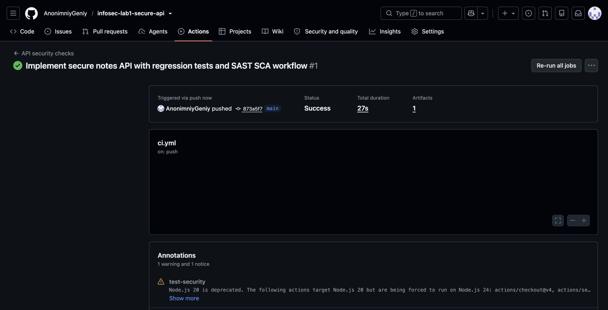
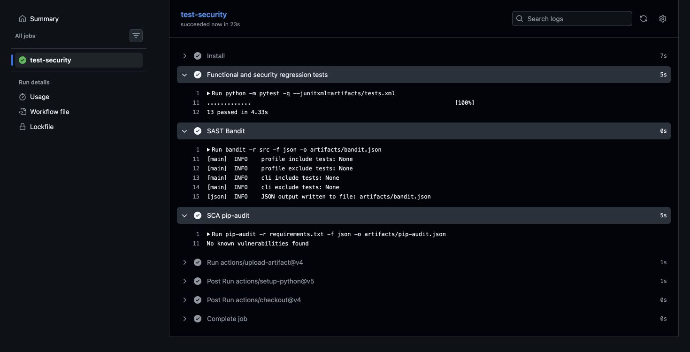

# Защищенный API заметок

Я разработал учебный API на Python 3.12, Flask и SQLite. Пользователь входит по логину и паролю, получает JWT и работает только со своими заметками.

## Запуск

```sh
python3 -m venv .venv
source .venv/bin/activate
pip install -r requirements-dev.txt
export JWT_SECRET="$(python -c 'import secrets; print(secrets.token_hex(32))')"
flask --app src.app:create_app create-user
flask --app src.app:create_app run --host 127.0.0.1 --port 5000
```

Создание пользователя интерактивное: пароль вводится скрыто и должен занимать 12–72 байта UTF-8. Секрет JWT задается окружением, база SQLite и окружение исключены из git. Сервер Flask используется только локально; при размещении за пределами учебного компьютера необходимы WSGI-сервер и HTTPS.

## Методы API

* `POST /auth/login`: JSON `{"username":"имя","password":"пароль"}`. При успехе 200, JWT в `access_token`, срок 900 секунд. Некорректные данные дают 400/401; после десяти попыток за минуту — 429.
* `GET /api/data`: заголовок `Authorization: Bearer <JWT>`. Возвращает `{"notes":[{"id":1,"text":"текст"}]}`; без действительного токена — 401.
* `POST /api/notes`: тот же заголовок, JSON `{"text":"Заметка"}`. Создает заметку, возвращает 201. Длина текста — 1–1000 символов, ошибки дают 400.

Пример вызова защищенного метода после получения токена:

```sh
curl -H "Authorization: Bearer $TOKEN" http://127.0.0.1:5000/api/data
curl -H "Authorization: Bearer $TOKEN" -H 'Content-Type: application/json' \
  -d '{"text":"Учебная заметка"}' http://127.0.0.1:5000/api/notes
```

`TOKEN` — токен из ответа метода входа, хранится временно в локальном окружении.

## Реализованные меры защиты

Все запросы к SQLite используют placeholders `?` и отдельные значения параметров. SQL-команды не собираются конкатенацией с вводом пользователя. Условия выборки заметок включают ID пользователя из проверенного JWT, а не из JSON запроса.

Пароли хешируются bcrypt с индивидуальной солью и cost=12. Для неизвестного логина также выполняется bcrypt-проверка фиктивного хеша. Открытые пароли не сохраняются. Вход ограничен десятью запросами в минуту на IP в рамках одного процесса; для нескольких процессов необходим общий счетчик.

JWT проверяется с фиксированным алгоритмом HS256, подписью и обязательными sub, exp, iat, iss, aud. Токены с другим audience/issuer, просроченные, неподписанные или подписанные другим ключом отклоняются. Существование пользователя проверяется по базе.

API возвращает JSON с корректным Content-Type; весь возвращаемый пользовательский текст экранируется MarkupSafe. В ответах присутствуют `X-Content-Type-Options: nosniff`, ограничительная CSP и `Cache-Control: no-store`. Клиент должен отображать текст безопасным способом, без декодирования сущностей и последующего присвоения в innerHTML.

Размер тела ограничен 16KiB. JSON проверяется по типам и длине полей. Браузерные cookies для аутентификации не используются: токен передается в Authorization.

## Проверки

```sh
mkdir -p artifacts
python -m pytest -q -k 'not test_sqli_and_xss' --junitxml=artifacts/tests.xml
bandit -r src -f json -o artifacts/bandit.json
pip-audit -r requirements.txt -f json -o artifacts/pip-audit.json
bash scripts/snyk_scan.sh
```

Тесты проверяют вход, создание и чтение заметок, изоляцию пользователей, хранение хеша, SQLi, XSS, отказ без токена, подделанные/просроченные/неполные JWT, недопустимый JSON, лимит размера тела и ограничение попыток входа.

В `.github/workflows/ci.yml` проверки запускаются на push, pull_request и вручную. Bandit выполняет SAST исходного кода. Основной SCA по заданию — Snyk Open Source; pip-audit сохранен как дополнительная проверка зависимостей. Любая находка этих инструментов или ошибка теста завершает соответствующий шаг с ошибкой; JSON-отчеты и JUnit сохраняются как Actions artifact `security-reports` даже при ошибках.

В текущем запуске исключен один ранее написанный совмещенный тест SQLi/XSS (`test_sqli_and_xss`); исходник сохранен. Выполняются 12 остальных тестов. Свежая проверка XSS не выполнялась; реализация параметризованного SQL и экранирования сохранена.

## Snyk Open Source

В CI добавлен настоящий `snyk test` для установленного Python-проекта и `requirements.txt` (CLI 1.1308.4). Запуск использует только repository secret `SNYK_TOKEN`; значение не хранится в коде и не печатается. При отсутствии секрета, ошибке установки/сканера или найденных уязвимостях шаг завершается с ошибкой. Пропуск Snyk не считается успешной проверкой. JSON-результат сохраняется как `artifacts/snyk.json`, а при отсутствии токена — `artifacts/snyk-status.json` с `scanCompleted:false`.

До добавления пользователем секрета и завершения нового запуска результат Snyk отсутствует. Предыдущие успешные запуски ниже относятся к конфигурации Bandit + pip-audit.

## Фактическая проверка curl

Я выполнил шесть HTTP-запросов настоящим curl: неправильный пароль → 401; успешный вход → 200; GET без JWT → 401; GET с JWT → 200; создание заметки → 201; чтение созданной заметки → 200. [Обезличенный raw HTTP-протокол](evidence/curl-http-redacted.txt) содержит запросы и ответы. Учебный пароль и JWT удалены перед сохранением. Скрипт повторения: `python curl_evidence.py` в активированном окружении.

## Предыдущие результаты GitHub Actions без Snyk

Проверки в [запуске № 1](https://github.com/AnonimniyGeniy/infosec-lab1-secure-api/actions/runs/43739233482) завершились успешно: 13 тестов, SAST Bandit и SCA pip-audit. Полные JSON-отчеты доступны в артефакте security-reports.




